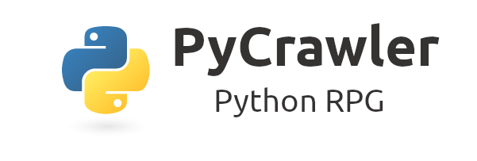

## PyCrawler



This is the repository of my first Python project: PyCrawler. It is a simple terminal-based RPG modeled around a roguelike playstyle.

## Installation
PyCrawler is available as a package via pip. To install it, run:

### macOS/Linux
```text
python3 -m pip install pycrawler-roguelite
```

### Windows
```text
python -m pip install pycrawler-roguelite
```

To play the game, run:
```text
pycrawler
```

## Roadmap:
- [x] Add the actual game play loop with functioning enemy spawn
- [ ] Add working art
- [x] Add some sort of loot system with basic upgrades
- [ ] More advanced stats like speed and armour
- [ ] Functionality for battles with multiple enemies
- [ ] A system for attack types and the introduction of resistance and weakness to different attack types
- [ ] A highscore system
- [ ] Maybe make a better logo

## Known Bugs
**Most of these stem from my lack of knowledge and experience, so please be patient**
- ~~Putting three or more "space" characters when selecting an an action will result in skipping the player's turn~~
- ~~The art does not display correctly on all terminals~~ **The art has been removed temporarilly as I could not resolve the issue. I do, however, plan on reimplementing it**
  
## Credits
The art would not have been possible without the amazing [px2ansi](https://github.com/Nellousan/px2ansi/tree/main) tool by Nellousan